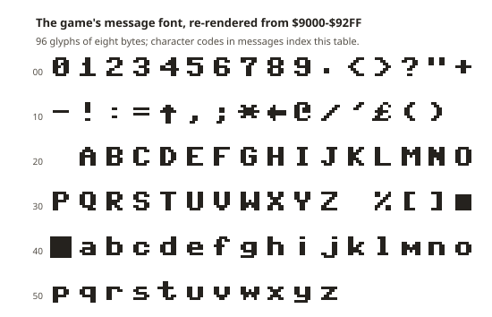

# Method

The guide is built in one direction only: from the disk image to the claim. Nothing is inferred from how the game "must" work, and no port is treated as evidence. This page describes the pipeline and the checks that keep the prose honest.

## 1. The image

The starting point is a D64 image of the original disk. Its files are extracted, the main program is located, and a full 64 KB memory image is captured from a running copy in VICE. The memory image is used for data tables (the type tables, the city names, the jump links, the font); the listings are used for code.

The data extraction is mechanical. A table is located by the routine that reads it, dumped from the memory image, and checked against the routine's indexing. For example, the jump destination table at `$8900` is indexed by `city * 4 + side`. On arrival, the game finds the return link and uses its slot multiplied by eight to read the coordinates at `$C4BF` and `$C4C0`.

## 2. The disassembly

The source generator reconstructs a byte map from the raw listings. It uses py65 to decode each curated code range in `tools/symbols.json` sequentially, from its start address to its exclusive end address. A routine can have additional blocks at separate addresses. The listing keeps the original byte columns:

```text
2C41: D1 61    CMP ($61),Y
2C43: B0 CF    BCS $2c14
2C45: A9 80    LDA #$80
2C47: 8D 96 03 STA $0396
```

The `Called by` index reads direct `JSR` and `JMP` instructions from those ranges and from the supplemental `caller_blocks` in the same symbol file. It records transfers to instruction addresses in documented routines, including their additional blocks. The index covers the curated code. Computed transfers through indirect `JMP`, fall-through paths and code outside those ranges require separate analysis.

## 3. The checks

Three kinds of check are used, in increasing order of strength:

1. **Data agreement.** A table's contents must make sense to every routine that reads it. The type tables, the jump links and the message font all pass this: the flags are consumed by the dispatcher, the links by both the departure and arrival code, the glyphs by the renderer.
2. **Code reading.** The behaviour is derived from the instruction stream, including the order of tests. Docking is a good example: the jump-pad type is tested before the dockable flag, so a pad never reaches the altitude or bearing checks. Reading the order is the only way to know that.
3. **Emulation.** VICE can show RAM values, the aperture in motion and messages as they appear in the game. For isolated arithmetic, py65 can execute the instruction bytes directly with specific inputs. For example, running the fuel burn routine at altitude zero with an intact tank confirms the `$0100` drop caused by the carry path.

When a claim cannot be observed (for example, a bit whose writer has not been found), the guide says "inferred" or leaves it open rather than inventing a purpose.

## 4. The figures

Every diagram is generated by `tools/build_diagrams.py` from the same constants the prose uses. The record grid, the docking wedge, the aperture timeline, the fuel curves and the death animation are all drawn from numbers such as the docking altitude 28, the 55-unit offset, the aperture ceiling `$48`, the 50-frame tick and the `$BFFF` tank. Changing a constant changes the figure.

The thirty-two city maps are drawn from `sources/data/cities.json`, which `tools/extract_cities.py` recovers record by record from the sheet at `$9400`. The script follows the game's own pointer arithmetic and terminator, so the maps are the data, not a redrawing of it.

Every figure is a standalone SVG file with its own styles. The Markdown pages embed them with relative image links.

The message font is a special case. Rather than approximating the game's typography, the font figure re-renders the actual 96 glyphs at `$9000`–`$92FF`, one bit per pixel:



*All 96 glyphs, drawn from the bytes the game itself uses. Codes `$00`–`$09` are digits, `$0A`–`$1F` and `$3B`–`$40` hold punctuation and symbols, `$20` is space, `$21`–`$3A` are capitals and `$41`–`$5A` are lower case. The message renderer indexes this table directly.*

That figure also settled a question the prose would otherwise have guessed at: the game's large "priority" messages are stored in four-byte groups, with a control byte followed by three characters, which is why the stored banner text appears to contain stray digits until the group structure is read.

## 5. Notation

- Addresses are hexadecimal and prefixed with `$`. The guide writes them as inline code so they are easy to spot and search for.
- Decimal values are used where a number is meant as a quantity (55, 72, 50 frames); hex is used where the byte matters (`$48`, `$BF`).
- "Cell" means one unit of the 256×256 city grid; a sub-cell is 1/256 of a cell.
- A record's bytes are numbered 0–15 from its base address.

## 6. Maintaining the generated material

The Markdown articles and images are ready to read. When the analysis or input data changes, contributors can refresh the routine pages, variables, type tables and figures. Use a Python virtual environment and run these commands from the repository root.

```sh
python -m pip install -r tools/requirements.txt
python tools/build_all.py
```

The script refreshes `sources/data/cities.json` from the listings before drawing the city maps. Update `tools/symbols.json` to change routine descriptions or variable names. To refresh the type table JSON from your own copy of the game, run the extractor on the PRG that loads at `$8900`, then rerun the generators.

```sh
python -I tools/extract_tables.py path/to/04_8900-CC00.prg
```

[Back to the guide](../index.md)
