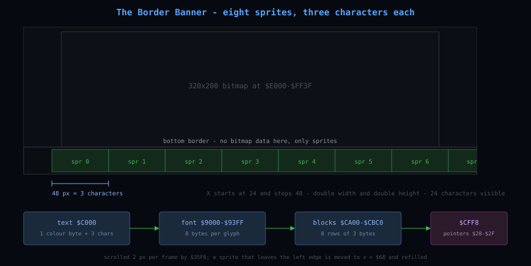

# The Border Banner

The scrolling line under the picture: eight sprites, a four-byte text format, and the story the game
tells you while you are not playing.

---

Leave Tau Ceti running and the bottom border starts to talk. A line of text crawls from right to
left under the panel - green, then orange, then light blue, then yellow - and when it runs out it
starts again. It is there from the first screen the game shows, and it is still there in the demo
after the mission has ended.

It is the only thing in the game drawn outside the 320x200 picture, and it is not drawn the way the
rest of the screen is. Everything else is pixels in the bitmap. This is not.

## The border is not being opened

The usual way to put anything in the lower border is to defeat the border itself: clear bit 3 of
$D011 at exactly the right raster line so the bottom edge never closes, then repoint the VIC at
memory past the end of the visible screen. Tau Ceti already writes $D011 four times a frame from
the table at $3964, and the value it writes at line 248 is $B0 - the 24-row setting, written after
the 25-row window has already passed the line where the bottom border would normally close. That is
the shape of a border-opening routine, and it would be the obvious explanation.

It is not what happens. The banner is eight hardware sprites, and the border is an ordinary closed
border with sprites sitting on top of it.

Three pieces of evidence:

- The handlers that run *above* the picture write zero to $D015, the sprite enable register. The
  handler that fires at line 248 copies a whole block of shadow registers into the VIC and switches
  all eight sprites on. Apart from a second shadow block at $FF40-$FF65, loaded by one other routine
  whose purpose I did not establish, that is the only sprite code in the game.
- The last eight bytes of the video matrix, $CFF8-$CFFF, hold $28 $29 $2A $2B $2C $2D $2E $2F while
  the banner is running: eight sprite pointers, pointing at $CA00, $CA40, $CA80 and so on - eight
  64-byte blocks of character graphics.
- Poking $CFE8-$CFFF, the matrix bytes that would supply the colours for the first rows *below* the
  picture if the border were open, changes nothing on screen. With the border open those rows would
  light up. They stay black.

So the row of text is not screen memory at all. It is the sprite layer, which the VIC-II draws
straight over the border without asking permission.

## Eight sprites, three letters each

The set-up routine is at $358E, called once from $56D1 as the game starts. It does four things:

- blanks 512 bytes at $CA00-$CBFF - the eight sprite blocks, all empty;
- gives the eight sprites X positions of 24, 72, 120 ... 360, which is 48 pixels apart, exactly the
  width of a double-width sprite, so eight of them tile the visible width edge to edge;
- sets every sprite to double width and double height ($D01D and $D017 both $FF) and colour 5;
- writes the pointers $28-$2F into the shadow block at $FF84-$FF8B and switches all eight on.

Blank sprites are 24x21 pixels. Doubled in both directions they are 48x42, and each one carries
three characters - a character is 8x8 source pixels, doubled to 16x16 on screen, so a sprite block
holds 3 x 8 pixels across. Eight sprites therefore show 24 characters, which is the 24-character
window the text scrolls through.

The characters themselves come from the font the message log uses, in three banks at $9000
(digits and punctuation), $9100 (capitals) and $9200 (lower case). The conversion is at $36B3: each
character byte is multiplied by eight, read as eight bytes of glyph, and then *transposed* into the
sprite block a byte at a time, so that each of the eight rows of the block holds one byte from each
of the three characters. That is why the text appears in the block in a scrambled-looking order
that only makes sense when the VIC reads it out as scanlines.

## The text

The words live at $C000-$C291, inside the file that loads at $8900. They are stored in four-byte
groups: one colour byte, then three characters. The colour byte is written to the sprite's colour
register, so each group of three characters gets the colour of the byte in front of it, and a
paragraph that opens with $01 stays white until the next colour byte arrives.

Seven paragraphs are chained together by a terminator: $FF followed by two bytes of pointer, which
is where the next paragraph starts. The last one points back at $C000, so the whole thing loops.

| Paragraph | Address | Colour | Text |
|---|---|---|---|
| 1 | $C000 | 5, green | `From CRL comes TAU CETI.` |
| 2 | $C027 | 8, orange | `Written by John Twiddy.` |
| 3 | $C04A | 14, light blue | `In 2050 the first wave of colonists left Earth, heading for the nearby Solar system of Tau Ceti.` |
| 4 | $C08D | 10, light red | `The new world thrived until without warning a great plague decimated the planet.` |
| 5 | $C143 | 3, cyan | `By the time a cure was found, the planet's defence system had taken over.` |
| 6 | $C1AA | 7, yellow | `The only way to stop the automatic defences was to shut down the fusion reactor that fueled the planet.` |
| 7 | $C240 | 1, white | `And like a fool you volunteered.` |

Note the digits: `2050` is drawn with glyphs $02 $00 $05 $00, because the digit glyphs sit at the
bottom of the first font bank, and the full stop is glyph $0A - two pixels at the baseline, which is
all an 8x8 cell can spare for one.

## The scroll

The routine at $35F6 runs once a frame, from whichever raster stage is live. It walks the eight
sprites, subtracting a step from each X position, and handles the two awkward cases that make a
strip of sprites wrap: a sprite crossing the 256-pixel line has its X most-significant bit toggled
in $FF76, and a sprite that has gone off the left edge is moved to x = $68 and refilled.

The refill is the interesting part. The sprite that has just left the screen is the one nobody can
see, so that is where the next three characters go: the routine takes the next colour byte, stores
it as that sprite's colour, reads three characters, and transposes them into the block. Three
characters per 48 pixels is 16 pixels per character, and the step is 2 pixels a frame, so the text
advances one character every eight frames - about 7.5 characters a second. The seven paragraphs come
to a little under five hundred characters, so a full pass takes around a minute.

The step itself is $0378, copied to $0397: two. It is not fixed. A message queued through the
four-byte entries at $0C80 can carry its own scroll step - the routine takes it from the low seven
bits of the entry's flag byte - which is why the ticker is not perfectly regular if the game has
something to say.

One thing is worth saying about $35F6 before leaving it, because the routine reads, in a listing, like
a piece of music software. It has a tempo byte, eight per-channel countdown timers at `$FF66-$FF75`
with flags at `$FF76`, a stream with a "continue" form and an urgent flag, and an inner loop that
renders three eight-byte glyphs into a 64-byte block per channel at `$CA00 + channel*64`.
What it is doing is the banner: the "channels" are the eight sprites, the "notes" are characters, and
the block it composes is the 48-pixel strip of three letters. Nothing else in the game writes to
`$CA00`, which is why the routine is easy to mistake for dead code - the VIC reads those blocks
through the sprite pointers at `$CFF8`, not the CPU. [Sound System](sound.md) has the other half of
that argument.

## When it runs

The ticker is not part of the loader. JEFF, the 508-byte loader at $0C00, contains no sprite code at
all: it sets the VIC to a blank bitmap screen, loads seven files, waits for SPACE and jumps to
$2000. The sprites are set up by the game's own start-up code at $56D1, so the banner cannot appear
during the file loads. The first screen it appears on is the credits screen that follows the SPACE
prompt, which is why the two get remembered as one thing.

The demo inherits it. The attract mode is the ordinary game restarted with the flag at $0394 set,
and the sprite set-up is part of that ordinary start. Nothing in the demo path touches $358E or the
sprite blocks, so the line keeps scrolling, comes round to `From CRL comes TAU CETI.` again, and
carries on.

## How it ends

It does not end - it loops - and it does not need to be switched off when play begins, because it
was never part of the picture. What hides it is leaving the flight screen. The eight sprites are
loaded by the handler that fires at line 248, and every other handler in the frame writes zero to
$D015 at its first instruction, so on the screens that do not go through that one call the banner is
not drawn at all. The border becomes an ordinary empty border for as long as those screens are up.

## What this corrects

Three chapters in this guide say there are no sprites in Tau Ceti. That was true of the world and
false of the screen: nothing that moves in the city is a sprite, but the border banner is eight of
them, and there is a second set of eight shadow registers at $FF40-$FF65 that the same two
routines load. [Moveable Elements](movables.md) and [Rendering Pipeline](rendering.md) now say so.

That second block is the flight view's own sprites - the crosshair and the sight marker - which is why
the block at $FF40 is loaded by $3375 every frame and not only for the banner. Measured from a
captured frame, the marker is a single hires sprite, single size, slot 3, at frame (406,125) in
colour 6: a 12x10 bracket, 32 pixels, and its 64-byte block reads back from the picture with no
ambiguous bits.

[Character Set and Text System](charset.md) described the font's third bank at $9200 as "not
identified". It is the lower-case alphabet: $9208 is `a`, $9228 is `e`, $9260 is `l`.

## What the port settled, and what it could not

Rendering the banner from its own blocks and comparing against a real frame settles the picture
exactly: eight hires sprites, double width and double height, 48 pixels apart, and drawing them
reproduces **all 1,412 lit border pixels and no others**. The characters read back as
`ste`, `m h`, `ad `, `tak`, `en `, `ove`, `r. ` - the tail of `...system had taken over.` - with 23 of
the 24 glyph cells matching a font glyph exactly, the last being half off the screen.

Two things remain open and are worth naming:

- **The two coordinate conventions do not reconcile.** The set-up routine writes shadow values that
  put sprite *i* at `24 + 48i` in its own frame; the picture needs `98 + 48i` in frame rows, and the
  Y coordinate that places the strip at row 260 is in the block but was not traced to its writer. The
  mechanism is not in doubt - sprites enabled at line 248, pointers at `$CFF8`, graphics at `$CA00` -
  but the register-level detail of the block is incomplete, and the port's geometry is fitted to the
  picture rather than read from the machine.
- **The per-stage `$D015` schedule is inferred, not logged.** Store watchpoints on the VIC registers
  do not fire on the emulator build used here, so the port reproduces the schedule the *picture*
  requires (rows 0-259 with the marker, 260-311 with the banner) rather than one observed in a trace.

---

[Back to the overview](../README.md)
