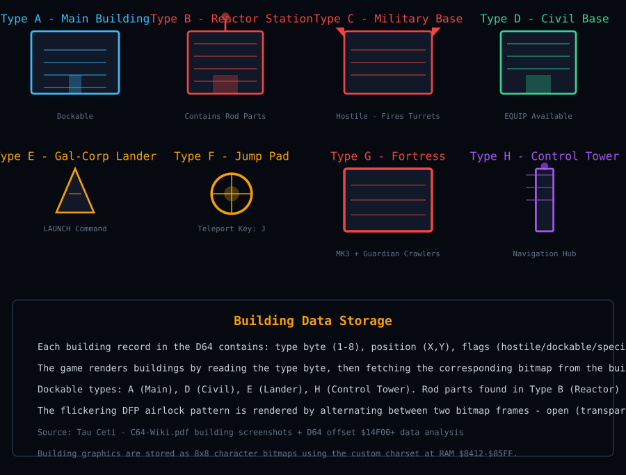

# Buildings and Interiors

Building types, interior graphics, energy-screened airlocks, shadows and docking.

---

A complete analysis of building types, interior bitmap graphics, shadow rendering, and the docking system.

## Building Types

Each city contains multiple buildings. The manual identifies these types:

| Type | Description | Interior Graphics |
|---|---|---|
| Reactor Station | Contains cooling rod parts | Bitmap of reactor interior with control panels |
| Military Base | Hostile building with defences | Bitmap of base interior with weapon systems |
| Civil Base | Allied building for resupply | Bitmap of supply interior with EQUIP terminal |
| Gal-Corp Lander | Your starting base | Bitmap of landing bay with LAUNCH console |
| Jump Pad | Teleporter between cities | Pad surface; the sand hoppers are records in the street beside it, see [Sand Hoppers](creatures.md) |
| Fortress | Heavily defended structure | Bitmap of fortress interior with MK3 robots |
| Turret | Defensive gun emplacement | Bitmap of turret control room |
| Control Tower | Navigation hub | Bitmap of tower interior with radar screens |

## Building Shapes - Visual Reference

The PDF identifies 8 building types with distinct visual shapes. The game renders each type as a unique bitmap pattern on the glider viewer screen. Here is how they appear:



## Building Data Storage

Each building record in the D64 holds a type byte (1-8), a position (X, Y), flags for hostile, dockable and special, and a pointer to the graphics data.

The game renders a building by reading the type byte, then fetching the corresponding bitmap from the building graphics table. Hostile buildings (types B, C and G) fire turrets when approached.

Dockable types are A (Main), D (Civil), E (Lander) and H (Control Tower). Rod parts sit in type B (Reactor) buildings, and EQUIP works at types D and E.

Building graphics are 8x8 patterns drawn into the bitmap by the glyph blitter at $3E17, from the pattern banks at $8E00 and $8F00 (see [Character Set and Text System](charset.md)). The DFP airlock flicker is rendered by alternating two bitmap frames, open with a transparent centre and closed as a solid rectangle.

## Interior Bitmap Graphics

Interior views are rendered as bitmap graphics stored in the D64. These are pre-drawn images that show the inside of each building type.

### Bitmap Storage

```text
Interior Bitmaps:
  Location: Scattered across tracks in the D64
  Format: 8x8 character bitmap data (custom charset)
  Each interior is ~200 bytes of bitmap data
  Stored as a sequence of character codes that map to the custom charset
```

### Example: Civilian Supply Interior

The civilian supply building interior shows a drinks machine and computer station. This is rendered using the custom charset characters arranged in a grid pattern:

```text
Civilian Supply Interior Layout:
  Row 0: "DRINKS MACHINE" label
  Row 1-3: Drinks machine bitmap (8x8 chars)
  Row 4: "EQUIP TERMINAL" label
  Row 5-7: Computer station bitmap (8x8 chars)

Each character is drawn as an 8-byte pattern by the blitter at $3E17
```

### Example: First Screen (Gal-Corp Lander)

The very first screen you see after boot shows a computer station with the board computer cursor. This is a bitmap graphic that sets the scene for the game:

```text
First Screen Layout:
  Top: "GREETINGS COMMANDER" message
  Middle: Computer station bitmap
  Bottom: Board computer prompt with flashing cursor
```

## DFP Energy Screened Airlocks

All buildings have DFP energy screened airlocks that open and close in a flickering pattern. This is a visual cue for docking timing.

### Airlock Flickering Algorithm

```text
Airlock Animation:
  Every frame, check the airlock timer
  If timer > threshold: airlock is OPEN (bright)
  If timer < threshold: airlock is CLOSED (dark)
  Timer increments each frame and wraps around

The flickering pattern is:
  OPEN for ~2 seconds
  CLOSED for ~1 second
  Repeat
```

> [!NOTE]
> **From the manual:** "All buildings have DFP energy screened airlocks which open and close in a flickering pattern. You must wait for the airlock to open and fly SLOWLY into the building." This means you need to time your approach carefully.

## Shadow Rendering

Buildings cast shadows based on the sun position (time of day). The shadow algorithm calculates the shadow direction and length for each building.

### Shadow Calculation

```text
Shadow Algorithm:
  1. Get sun angle from current spin (time of day)
  2. For each building:
     a. Calculate shadow direction = sun_angle + 180
     b. Calculate shadow length = building_height / tan(sun_elevation)
     c. Draw shadow polygon extending from building base
     d. Shadow colour = dark version of building colour
```

## Docking System

The docking system requires precise timing and speed control:

| Requirement | Detail |
|---|---|
| Speed | Must be slow (use // key to reduce) |
| Airlock Timing | Wait for the flickering pattern to open |
| Direction | Fly into the airlock opening (not sideways) |
| Command | L key initiates landing sequence |
| Success condition | Speed < threshold AND airlock OPEN AND aligned |

## Summary

Tau Ceti's building system combines bitmap interior graphics with animated airlocks and shadow rendering. The docking mechanics add a timing element that requires player skill, while the interior views provide visual context for each building type.

---

[Back to the overview](../README.md)
