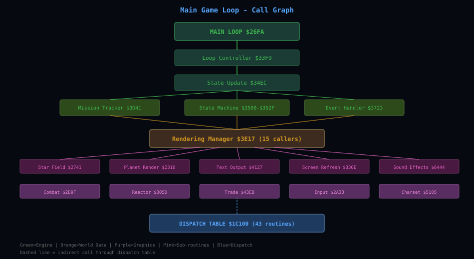
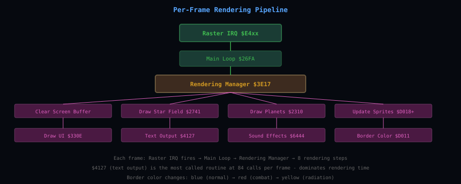
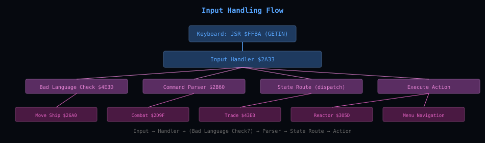
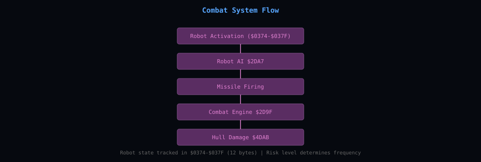

# Call Graph and Rendering Pipeline

Call graphs for the main loop, rendering, input, combat and the raster handler.

---

### Main Game Loop Call Graph



### Rendering Pipeline



### Dispatch Table State Machine

The dispatch table at RAM $1C100 contains 43 entry-point routines that form a state machine. Each routine handles a specific game state or menu option:

| Routine # | RAM Address | Size | First Action | Purpose |
|---|---|---|---|---|
| 0 | $1C100 | 92 bytes | ASL $12,X / PLA / CMP #$50 | State routing (checks state >= $50) |
| 1 | $1C15D | 45 bytes | EOR #$01 | State toggle / flag check |
| 2 | $1C18B | 14 bytes | BRANCH | Conditional jump based on state |
| 3 | $1C19A | 65 bytes | BRANCH | State validation |
| 4 | $1C1DC | 28 bytes | CLC | Arithmetic preparation |
| 5 | $1C1F9 | 37 bytes | TAY | Index setup |
| 6 | $1C21F | 218 bytes | JSR $27EC | Menu routine |
| 7 | $1C2FA | 74 bytes | JSR $27EC | Menu routine |
| 8 | $1C345 | 175 bytes | BRANCH | Combat state handling |
| 9 | $1C3F5 | 287 bytes | OP $2B (BMI) | Input handler for combat |
| 10 | $1C515 | 783 bytes | OP $B9 (LDA abs,Y) | Reactor mission interface (largest routine) |
| 11-16 | $1C825-$1CAE9 | Variable | Mixed | Various state handlers |
| 17 | $1C97E | 225 bytes | OP $BD (LDA abs,X) | World data access |
| 37 | $1CEEF | 8 bytes | JSR $330E | Screen update call |
| 38+ | $1CEF8+ | Variable | Mixed | Remaining state handlers |

### Input Handling Flow



### Combat System Flow



### Raster Interrupt Handler

The raster interrupt handler at file offset $1D338 (RAM $1DB38) fires at a specific VIC-II scan line and calls the main game loop:

```asm
$1DB38: Raster IRQ Handler
$1DB38:   PHA                 ; Save accumulator
$1DB39:   TXA                 ; Save X register
$1DB3A:   PHA
$1DB3B:   TYA                 ; Save Y register
$1DB3C:   PHA
$1DB3D:   JSR $26FA           ; Call main game loop
$1DB40:   PLA                 ; Restore Y
$1DB41:   TAY
$1DB42:   PLA                 ; Restore X
$1DB43:   TAX
$1DB44:   PLA                 ; Restore A
$1DB45:   RTI                 ; Return from interrupt
```

The raster line is set via STA $D012, and the IRQ is enabled via STA $D015. This provides consistent frame timing regardless of the C64's CPU speed variations.

### Charset Initialization Code

The charset initialization at game offset $381C (RAM $401D) builds the lookup table:

```asm
$401D: CHARSET INITIALIZATION
$401D:   LDA #$12          ; Start of lookup table ($8412)
$401F:   STA $0003         ; Low byte of table pointer
$4022:   LDA #$84
$4024:   STA $0002         ; High byte of table pointer
$4027:   LDA #$00          ; Counter = 0
$4029:   STA $0001

$402B: BUILD LOOKUP TABLE
$402B:   LDA $0001         ; Load counter
$402D:   CMP #$40          ; 64 entries (0-63)
$402F:   BCS $4041         ; Done when counter >= 64
$4031:   LDA charset_source,X ; Read source byte
$4034:   EOR #$FF          ; Apply XOR transformation
$4036:   STA ($0003),Y     ; Store in lookup table
$4038:   INC $0001         ; Increment counter
$403A:   INX
$403B:   JMP $402B         ; Next entry
```

---

[Back to the overview](../README.md)
