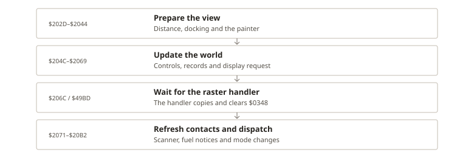

# One frame in the skimmer

Tau Ceti's flight loop prepares a view, updates the record table, and waits for a raster interrupt to copy the picture. Then it refreshes the scanner and checks whether the pilot should stay in flight. The order explains which parts of a frame see the previous set of values.

*An ordinary pass through the foreground loop. The raster interrupt also schedules work such as the flight clock and sound.*

## Preparing the view

The foreground loop starts at `$202D`. A pending collision effect at `$0392` takes a short path through `$464E`. On the ordinary path the loop sets up the background, then calls `$29B6` at `$2044`. That call enters the proximity scan and painter.

The proximity pass recomputes the records' active bits and distances for the current ship position. The painter draws from that information and publishes its target pointers before returning to the caller. At `$2047` the loop tests `$0396`. A set high bit means the docking path has accepted the ship, and the branch leads directly to the mode checks at `$207A`. The article on [the viewport](the-viewport-in-flight.md) follows the work inside the painter.

## Updating records and handing over the picture

On the ordinary flight path the loop sets `$0348` to `$80`, updates cockpit state and calls the record dispatcher at `$2057`. The dispatcher uses the active bits set by the proximity pass to decide which AI and aperture routines get a turn. It also turns dying records into free slots and publishes the sensor count and warning flags at the end of the sweep. [The record table](the-record-table.md) describes the two passes in detail.

At `$206C` the foreground waits for `$0348` to return to zero. The raster handler at `$49BD` checks for `$80`, claims the request by writing `$FF`, waits until the raster reaches at least `$40`, calls the bitmap copy at `$223E`, then clears the byte. The intermediate `$FF` keeps the request from being treated as a fresh one while the copy is in progress.

One foreground pass covers a new viewport image. The raster schedule continues at the display's cadence, and the [bitmap copy timings](the-viewport-in-flight.md#cpu-cycles-and-viewport-updates) show why those two rates differ.

## What the interrupt is doing

The raster handler at `$3903` acknowledges the VIC-II interrupt, programs the next raster line and cycles a four-step index at `$006F`. The active display/game state in `$039D` also enters the dispatch calculation. Different handlers can run on different raster phases of the same screen refresh.

The ordinary flight entries in the table at `$498A` give each phase its own jobs. The table stores each entry address minus one because the dispatcher pushes it and uses `RTS` to enter the handler.

| Phase | Entry | Work |
| --- | --- | --- |
| 0 | `$49BA` | Publish sprite state and service the pending bitmap copy. |
| 1 | `$49D9` | Sample input, check [laser fire](../source/routines/laser-fire.md), cool the laser and update the [bolt](../source/routines/laser-bolt.md). |
| 2 | `$49FD` | Check ground contact and call the [frame tick](../source/routines/frame-tick.md) if `$0395` is clear. |
| 3 | `$4A0C` | Run the controls and compass update and jump to the [SID driver](how-tau-ceti-drives-the-sid.md). |

The controller reads speed, turn and altitude at `$3968`. The turn rate is accumulated into the ship's heading and the translation path at `$3A42` uses bit 0 of the frame count. On odd ticks it looks up the heading components, scales them by speed and adds them to the position. That position has a cell byte and two fractional bytes per axis, so small changes can accumulate before the whole cell changes. The frame tick counts fifty frames before the mission clock, shield and fuel take their one-second step.

## Choosing what happens next

After the wait, `$2071` refreshes the scanner, `$2074` checks the fuel notices, and `$2077` calls the handler that can wait for the pilot after an interruption. The mission-end test at `$207A` comes first. The remaining dispatch at `$208C` checks four flags.

| Address | When the flag is set |
| --- | --- |
| `$0381` | Jump to the handler at `$4D60`, which handles a refused dock or depletion of shields. |
| `$039B` | Enter the jump sequence at `$511E`. |
| `$03BA` | End the recorded demonstration through the handler at `$645A`. |
| `$0396` | Hand over to the board computer at `$4D73`. |

The table is in dispatch order. If all four bytes are clear, execution branches back to `$202D`. If the scan requested a jump and also left a refusal pending, the refusal handler gets the first decision. This is one reason to trace a flag from its writer through the end of the loop. Seeing the write alone does not tell you which path runs next.

[Back to Deep Dives](index.md)
