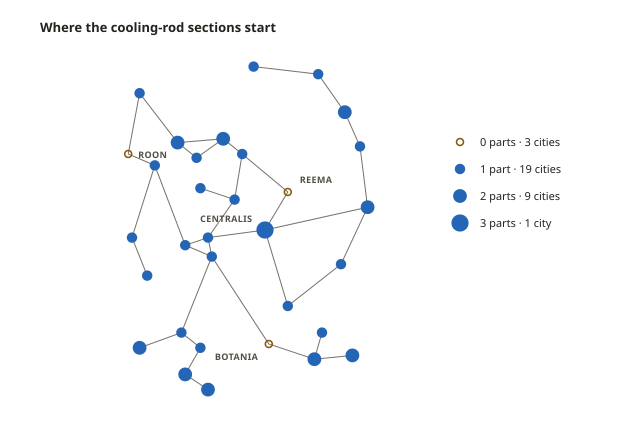

# How the cooling rods work

Every new game makes forty rod sections, shuffles them, and deals them out as you dock. The city table fixes how many sections you find at each site. Two bytes per section carry the shape and pattern that determine which halves fit.

## The draw pile

At `$7328` the generator calls the game's random-byte routine at `$330E`, writes a pattern byte into the first half, and XORs it with `$55` to make the partner's pattern. The following instructions set the low two bits of the second half from the first, toggling bit 0, then choose the rest of its shape. The generator advances four bytes per pair until it has filled `$50` bytes at `$02B0`. That is twenty pairs of two-byte sections.

The shuffle at `$7378` walks the forty entries. For each one it masks a random byte to six bits, retries values of 40 and above, and swaps both bytes of the selected entry. The random choice can name any of the forty slots on each pass, including earlier ones.

## Where parts are found

The byte at `$7440 + city` gives the city's stock. Centralis has three parts, nine cities have two, nineteen have one, and Reema, Roon and Botania have zero. Your route decides which cities give you the first entries in the shuffled pile.

*Part counts at `$7440`, plotted using the game's planet coordinates and jump links. Centralis holds the three-part stock. Hollow circles mark cities with zero parts.*

At `$73C4`, the pickup code accepts the Central Reactor and substations, types 28 and 29. It sets bit 7 of the city's stock byte on the first visit and skips the site when that bit is already set. It then fills vacant cargo entries at `$BC50` with indices from the shuffled pile, advancing the total found at `$03A7`. The indices are enough to refer to any of the eighty bytes of part data.

## What makes a pair fit

The `RODS` bench begins at `$6D0E`. Each chosen cargo entry points to a two-byte section. The test at `$6E26` gets three answers from those four bytes.

| Test | What the 6502 checks | A pair that passes |
| --- | --- | --- |
| Pattern | XOR the second bytes and compare with `$55`. | `$AB XOR $FE = $55` |
| Orientation and ends | XOR the first bytes, mask with `$83` and compare with `$81`. Bits 7 and 0 must differ, and bit 1 must agree. | `($20 XOR $A1) AND $83 = $81` |
| Profile | Take bits 4–6 of each first byte and use them as indices into the table at `$7173`. Compare the two results. | Both indices are 2, which yields 2. |

The profile table is `6, 5, 2, 9, 2, 9, 5, 6`, so different indices can describe compatible ends. That is why comparing those three bits directly would give the wrong answer. The bench can change the encoded parts. At `$6F9B` and `$6FB3` it toggles bits 6 and 7, and the operation at `$6FF1` transforms the pattern in two-bit groups.

The table's example uses the illustrative halves `20 AB` and `A1 FE`. Change the second half to `21 FE` and the orientation test fails. Change it to `B1 FE` and the profile test fails. Change it to `A1 FF` and the pattern test fails. The original match code branches to `$6E66` for the accepted pair and to `$6E30` for each of those failures. On success it increments `$03A8` and clears the two bench entries.

## Inserting the rods at Centralis

The `REACTOR` command at `$770B` checks the docked type for 28. Inside, the twenty bytes at `$03DB` record which sockets are filled. The selection code at `$7815` draws a random slot number and retries until it finds an empty one. The interface first lets the player pick up a completed rod, then checks that the chosen socket matches the requested slot. It writes `$FF` into the socket at `$7893` and increments the inserted count at `$03A9`.

The room keeps time while you work. At `$790E` it increments radiation exposure in `$03BE` and compares that byte against a series of warning thresholds. The inserted count determines the shutdown. The room's exit handler at `$7973` tests it against `$14` before taking the completion path.

The full progression is visible in three adjacent counters. `$03A7` counts sections recovered, `$03A8` counts pairs assembled, and `$03A9` counts rods inserted. See [The 32 cities](the-32-cities.md) for how the game loads the sites and [Docking and the aperture](docking-and-the-aperture.md) for what gets the pilot through the door.

[Back to Deep Dives](index.md)
