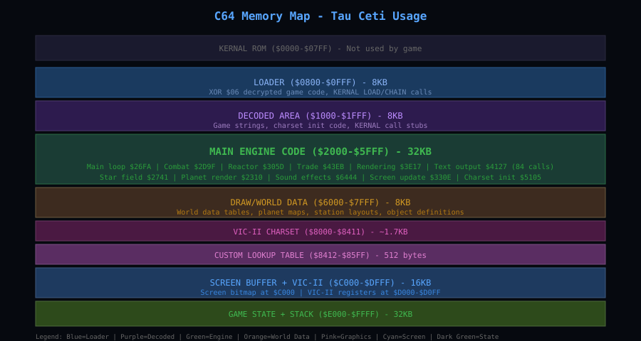

# Memory Map

The full 64KB map: what lives where, and which VIC-II and SID registers the game touches.

---

Tau Ceti fills the machine. The game code sits at $2000 and runs to $88FF, the data files occupy
$8900-$CCFF and $D000-$DFFF, and the screen hardware points into the top of memory: bitmap at
$E000, video matrix at $CC00, colour RAM at $D800. The loader in the bottom quarter is overwritten
almost as soon as the game starts.

## Complete Memory Map

| Range | Contents |
|---|---|
| $0000-$00FF | zero page: pointers, counters, the raster stage byte |
| $0100-$01FF | stack; $0100-$0110 hold the live key map |
| $0200-$03FF | game variables (page 3 holds the flight state, gauges and ammo) |
| $0400-$0BFF | flight-view canvas and its working area |
| $0C00-$0CFF | loader, then the two message-queue ring buffers |
| $0D00-$0DFF | small table read by the object code at $3915 |
| $0E00-$10FF | 48 object records, 16 bytes each |
| $2000-$88FF | game code |
| $8900-$8FFF | city data, including the name table at $8D04 |
| $9000-$92FF | glyph banks used by the message log |
| $9300-$93FF | demo script: hold counts |
| $BD00-$BDFF | demo script: joystick actions |
| $C39A-$C3FF | object type table and per-type data |
| $CC00-$CFFF | video matrix (1000 bytes used) |
| $D000-$DFFF | replacement I/O routines (loaded from `I/O 4K`) |
| $D800-$DBFF | colour RAM (1000 bytes used) |
| $E000-$FF3F | the bitmap |
| $FFFE-$FFFF | hardware IRQ vector, holding $3903 |

## Region Breakdown

### $0000-$00FF: Zero Page

The zero page holds the working state the code touches most often:

| Address | Use |
|---|---|
| $01 | CPU port; the loader switches RAM in and out with it |
| $11 | a frame counter, incremented once per frame at $25D3 |
| $26-$27 | scratch for the 8-bit multiply in the object code |
| $61-$62 | general pointer, used by the record scanner and the sound code |
| $67-$69 | counters and saved indices inside drawing routines |
| $6F | the current raster stage, 0-3 |
| $C6 | KERNAL keyboard buffer length, cleared each frame at $4DA9 |
| $DA-$DB | projected position used by the drawing code |

### $0100-$0110: The Key Map

Ten bytes of key codes, read one at a time by the key-test routine at $3D18. A game start restores
them from a saved copy at $03EF with the routine at $6403, which is how the demo hands control back
without inheriting a remapped keyboard.

### $0200-$03FF: Game Variables

Almost everything the game tracks lives here, at absolute addresses rather than in the zero page:

| Address | Variable |
|---|---|
| $0334 | sight/flag byte toggled at $3B20 |
| $033B-$033F | sight position, computed each frame by the projection helpers |
| $0344 | height |
| $0346 | fuel |
| $0347 | a slowly decaying gauge |
| $034A-$0351 | joystick shadow bytes: the eight input bits the flight model reads |
| $0352 | turn rate |
| $0353 | speed |
| $0355 | flares |
| $0356 | flare timer |
| $0357 | AMM |
| $0358 | missiles |
| $0359 | AMM flash flag |
| $0365-$0367 | weapon cooldown timers: flare, missile, AMM |
| $0377 | a gauge that fills to $BF |
| $0379 | general-purpose timer |
| $0383/$0384 | message queue write and read pointers |
| $0394 | demo flag: non-zero means attract mode |
| $0396 | flight state: 0 launched, 1 landed, 2+ docked |
| $039D | display mode, ORed into the raster dispatch index |
| $03C4/$03C5 | effect/sound selectors |
| $03EF-$03FF | saved key map |

### $0400-$0BFF: The Flight View

The flight view is drawn in a small canvas at $0400, eight rows of 64 bytes, two bits per pixel.
The operator at $3F93 walks the object records and paints into it; the blitter at $3F29 then copies
it out to the bitmap in eight bands at $E870, $E9B0, $EAF0, $EC30, $ED70, $EEB0, $EFF0 and $F130.
A second blitter at $223E reads a wider area, $0400-$0BFF, and writes strips into $E148, $E288 and
onward, separating even and odd destination bytes.

### $0C00-$0CFF: Loader, Then Message Queue

When the disk boots, this is JEFF. Once the game is running, it is two ring buffers: $4127 appends
two-byte entries at $0C00 and $413B appends four-byte entries at $0C80. The loader does not survive
the first message the game prints.

### $0E00-$10FF: The Object Table

Forty-eight records of sixteen bytes. Byte 0 is a type index into the table at $C39A, byte 3 holds
flags ($40 drawn, $08 variant), bytes 10-11 are a 16-bit X position and bytes 12-13 the depth.

The table is built at run time by $280B from per-city object lists, pointed to by the city number
at $0354, which is why the bytes on the original disk do not match the table in a running game.

### $2000-$88FF: Game Code

The main body of the program, loaded from `2000-8900`. Entry is at $2000 with `LDX #$FE / TXS` and
five `JSR`s into the start-up routines; the frame loop begins at $4D80 and the hardware IRQ handler
at $3903.

### $8900-$92FF: City Data and Glyphs

The city name table is at $8D04, thirty-two names separated by $C0. Above it, $9000-$92FF holds
three banks of glyphs used by the message log: bank 0 is digits and punctuation, bank 1 is A-Z with
a blank first, and bank 2 is not identified.

### $CC00-$CFFF: Video Matrix

The VIC-II is pointed here by $D018 = $38 (`$3D` while the loader owns the screen), giving 1000
bytes of matrix for a 40x25 screen in multicolour bitmap mode.

### $D000-$DFFF: Replacement I/O

`I/O 4K` is loaded at $4000 and copied down here under the I/O bank. This is the game's own screen
and input code, running where the KERNAL's I/O normally lives.

### $E000-$FF3F: Bitmap

8000 bytes, one 320x200 multicolour bitmap, displayed from VIC-II bank 3. The last 192 bytes of the
bank are not part of the picture: $FFFE holds the IRQ vector, which is $3903.

## VIC-II Register Access

The game uses a normal multicolour bitmap screen and raster splits. The registers it actually
writes:

| Register | Address | Purpose |
|---|---|---|
| $D011 | $D011 | screen control: bitmap mode, display enable, vertical scroll |
| $D012 | $D012 | raster compare - which line the next split fires on |
| $D016 | $D016 | horizontal scroll and multicolour enable |
| $D018 | $D018 | video matrix and bitmap base pointers |
| $D019 | $D019 | interrupt status, acknowledged every frame |
| $D01A | $D01A | interrupt enable |
| $D01B-$D01D | $D01B-$D01D | sprite priority, multicolour and size, used only for the border banner |
| $D020/$D021 | $D020/$D021 | border and background |
| $D027-$D02E | $D027-$D02E | sprite colours, one per banner character group |
| $DD00 | $DD00 | VIC bank select; bits 0-1 = %00 selects bank 3, $C000-$FFFF |

Nothing in the bitmap is a sprite. The eight sprites at $D000-$D01D belong to the scrolling line in
the bottom border, which is enabled for the bottom band of the frame and switched off again above
it; see [The Border Banner](border-banner.md).

## SID Register Access

Sound is small and direct. Two voices, no music player, no filter sweep:

| Register | Address | Purpose |
|---|---|---|
| $D400-$D406 | voice 1 | frequency, pulse width, control, attack/decay - written as a block through `STA $D400,Y` from a parameter table |
| $D40E/$D40F | voice 2 frequency | effect pitch |
| $D412/$D413 | voice 2 pulse width | timbre |
| $D414 | voice 2 control | waveform, gate, attack/decay |
| $D418 | volume and filter mode | master output |

Voice 1 is set up as a block from a table (the indexed stores run from $D400 to $D406); voice 2 is
poked register by register. Each effect is a short hand-written routine that sets a frequency,
opens a gate and closes it again.

> [!NOTE]
> The old version of this chapter listed the SID at $C000-$C01F. The SID is at $D400-$D41C; $C000
> is ordinary RAM in this game.

---

[Back to the overview](../README.md)
