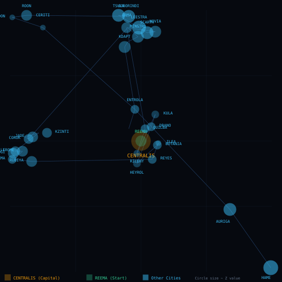
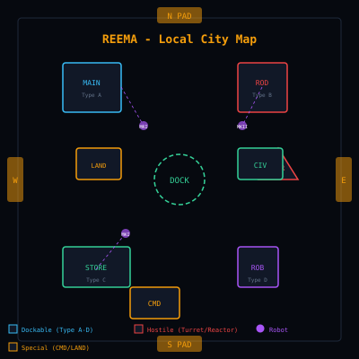

# World and Cities

The 32 cities, their coordinates, the jump pad network, reactors and cooling rods.

---

A complete analysis of the 32 cities, their data structures, coordinate systems, and the jump-pad network that connects them.

## The Planet Tau Ceti (III)

The game takes place on the planet Tau Ceti (III), a rocky world with 32 named cities spread across its surface. The planet has no moon, which means there is no natural night-light - you need infrared mode to navigate after dark.

> [!NOTE]
> **Key fact from manual:** "Tau Ceti III is a planet with no moon. At night the only way to see is through the infrared scanner." This is why the infrared toggle (I key) is essential for nighttime play.

## The 32 Cities

Each city is a distinct location on the planet surface, containing multiple buildings, defence systems, and potentially cooling rod parts. The cities are stored in the D64 at file offset $14B0E as a contiguous list of encoded names, separated by $C0 bytes.

### City Name Data Structure

The city names are stored at file offset $14B0E to $14BE3 (196 bytes), with each name using the game's custom charset encoding. Names are separated by the byte $C0 (which maps to the space character in the charset).

```text
File Offset  $14B0E-$14BE3: City Name Table
Format:     [encoded_name]$C0[encoded_name]$C0...
Total:      32 city names, ~6 bytes average
Separator:  $C0 (space in custom charset)
Charset:    Custom lookup table at RAM $8412-$85FF
```

### The Complete City List (D64 Internal Order)

The D64 stores cities in a specific internal order. Each name is XOR-encoded with key `$60`. Entry 1 is **REEMA** (starting city); entry 0 is **CENTRALIS** (capital). The manual's listing order differs from the D64 order.

| # | City | X | Y | Z | W | # | City | X | Y | Z | W |
|---|---|---|---|---|---|---|---|---|---|---|---|
| 0 | CENTRALIS ★ | 0 | 0 | 0 | 0 | 16 | KRILL | 5 | 138 | 104 | 13 |
| 1 | REEMA → | 0 | 0 | 0 | 0 | 17 | DRANO | 138 | 114 | 23 | 130 |
| 2 | HAME | 254 | 252 | 244 | 232 | 18 | KDAPT | 112 | 36 | 130 | 100 |
| 3 | AURIGA | 215 | 195 | 172 | 147 | 19 | KZINTI | 36 | 120 | 106 | 36 |
| 4 | ENTROLA | 122 | 97 | 73 | 51 | 20 | HEYROL | 124 | 150 | 22 | 154 |
| 5 | CERITI | 32 | 17 | 7 | 2 | 21 | SCARTH | 134 | 22 | 140 | 150 |
| 6 | ZOON | 2 | 7 | 17 | 32 | 22 | JADE | 22 | 124 | 136 | 22 |
| 7 | ROON | 16 | 5 | 116 | 12 | 23 | BOTANIA | 144 | 132 | 29 | 146 |
| 8 | QUILBA | 132 | 116 | 0 | 128 | 24 | MINSTRO | 122 | 31 | 132 | 154 |
| 9 | ERMA | 114 | 17 | 132 | 110 | 25 | FROME | 12 | 138 | 132 | 0 |
| 10 | CORUK | 18 | 126 | 108 | 14 | 26 | ILEA | 142 | 130 | 1 | 142 |
| 11 | RILENY | 124 | 140 | 6 | 142 | 27 | LEESTRA | 126 | 17 | 146 | 126 |
| 12 | GOBORINDI | 116 | 6 | 140 | 116 | 28 | PREEMA | 2 | 146 | 134 | 13 |
| 13 | ZILOGI | 3 | 140 | 118 | 25 | 29 | REYES | 136 | 146 | 18 | 136 |
| 14 | KULA | 142 | 102 | 25 | 146 | 30 | NOVIA | 142 | 21 | 130 | 138 |
| 15 | TSULA | 106 | 5 | 140 | 108 | 31 | RUBIYA | 21 | 148 | 142 | 9 |

> [!NOTE]
> **Decoding:** City names are stored XOR-encoded with key `$60`. For example, byte `$23` → 'C' ($23 XOR $60 = $43), byte `$35` → 'U' ($35 XOR $60 = $55). All names stored uppercase. Note: D64 has "ENTROLA" not "Entroia", "ERMA" not "Erna", "HEYROL" not "Keyrol", "RUBIYA" not "Rubya" - these are the actual in-game names.

> [!WARNING]
> **Special cities:** CENTRALIS (entry 0) is the capital containing the Main Central Reactor. REEMA (entry 1) is the starting city. Both have zero coordinates in the D64 - CENTRALIS is the mission destination, REEMA is where you begin.

## City Coordinate Data

Each city has 4 bytes of coordinate data stored sequentially after the name list at file offset $14BE4. These coordinates define the city's position on the planet surface for map rendering and navigation.

```text
File Offset  $14BE4-$14D00: City Coordinate Table
Format:     [X][Y][Z][W] per city (4 bytes each)
Total:      32 cities x 4 bytes = 128 bytes
First entry: Often zero coordinates (padding)
```

### Coordinate System

The 4-byte coordinate structure represents:

| Byte | Name | Purpose |
|---|---|---|
| X | Horizontal position | East-west position on the planet map |
| Y | Vertical position | North-south position on the planet map |
| Z | Depth/altitude | Height above surface or depth into terrain |
| W | Size/extent | City size or radius for rendering scale |

## Jump Pad Network

Cities are connected by "Super-Traveller" jump pads located at the N/S/E/W ends of each city. These are non-programmable teleporters that allow instant travel between cities.

### Planet Map - City Network Visualization

The following SVG renders all 32 cities using their X/Y coordinates from the D64 data. Circle size encodes Z (depth) value. CENTRALIS (capital, gold) and REEMA (starting city, green) are highlighted.



> [!NOTE]
> **Reading the map:** X coordinate maps to horizontal position (0=left edge, 255=right edge), Y to vertical (0=top, 255=bottom). Circle radius is proportional to Z (depth/altitude). Cities cluster in three groups: top edge (high Z), left edge, and center-right. CENTRALIS and REEMA are both at (0,0) raw coordinates but rendered at screen center for visibility.

> [!NOTE]
> **From the manual:** "The jump pads are situated at the N/S/E/W ends of the cities. They are non-programmable 'Super Traveller' type." This means you cannot program your own destinations - the pads automatically connect to their paired pad in another city.

### Jump Pad Mechanics

| Feature | Detail |
|---|---|
| Type | Non-programmable "Super Traveller" |
| Location | N/S/E/W ends of each city |
| Sand Hoppers | Found near jump pads - small ground vehicles |
| Teleport Key | J key teleports you to the nearest jump pad |
| ADF Guidance | Lower ADF always points to the closest jump pad |

## Building Types by City

Each city contains a variety of buildings. The manual identifies these types:

| Building Type | Description | Special Features |
|---|---|---|
| Reactor Stations | Contain cooling rod parts (your primary objective) | DFP energy screened airlocks, flickering pattern |
| Military Bases | Hostile buildings with defensive systems | Turrets, robot hunters, proximity mines |
| Civil Bases | Allied buildings for resupply | EQUIP command works here (refuel/rearm) |
| Gal-Corp Lander | Your starting base | LAUNCH command, EQUIP available |
| Jump Pads | Teleporters between cities | J key for teleportation |
| Fortresses | Heavily defended military structures | MK3 robots, guardian crawlers |
| Turrets | Defensive gun emplacements | Fires at your skimmer |
| Control Towers | Navigation and communication hubs | May contain intelligence data |
| MK1 Robots | Basic hostile robots | Slow, easy to destroy |
| MK2 Robots | Intermediate hostile robots | Faster, more dangerous |
| MK3 Robots | Advanced hostile robots | Hunter-killers, highly aggressive |
| Guardian Crawlers | Heavy defence units | Slow but powerful |
| Civil Buildings | Non-hostile structures | No weapons, may contain supplies |

## Docking Mechanics

To land at a building, you must dock with it. The manual describes the docking process:

> [!NOTE]
> **From the manual:** "All buildings have DFP energy screened airlocks which open and close in a flickering pattern. You must wait for the airlock to open and fly SLOWLY into the building." This means timing is critical - you need to approach slowly when the airlock is open.

### Docking Requirements

| Requirement | Detail |
|---|---|
| Speed | Must be slow (use // key to reduce speed) |
| Airlock Timing | Wait for the flickering DFP pattern to open |
| Direction | Fly into the airlock opening (not sideways) |
| Command | L key initiates landing sequence |

## Cooling Rod Parts

The primary objective is to collect 40 cooling rod parts from reactors across the cities and assemble them into 20 cooling bars.

| Step | Action | Result |
|---|---|---|
| 1 | Fly to a reactor station | Land at the building |
| 2 | Use LOOK command | View the interior |
| 3 | Navigate to the reactor | Find the cooling rod parts |
| 4 | Collect parts | Add to inventory (max 40) |
| 5 | Use RODS command | Assemble pairs into bars |
| 6 | Fly to Centralis | Go to the main reactor |
| 7 | Use REACTOR command | Insert cooling bars |
| 8 | Repeat until all 20 bars inserted | Mission accomplished |

## City Navigation

Navigating between cities involves several systems working together:

| System | Purpose | Key |
|---|---|---|
| Compass | Points to city centre | Always visible in instruments |
| ADF (Upper) | Points to current city centre | Right side, upper ADF |
| ADF (Lower) | Points to closest jump pad | Right side, lower ADF |
| Radar | Shows nearby buildings and threats | S key toggles scan mode |
| Infrared | Night vision with blur effect | I key toggles infrared |

## City Data in Code

The city data is accessed through the dispatch table at file offset $1B900. The game maintains a "current city" index in zero-page memory, which is updated when you teleport via jump pad or fly into a new city's airspace.

```asm
City Data Access Pattern:
  LDA current_city_index    ; Get current city number
  LDX #$14BE4               ; Point to coordinate table
  LDA (X), Y                ; Read X coordinate
  ...
  JSR draw_city_on_map      ; Render on map screen
```

## Jump Pad Connection Map

While the exact jump pad pairings are not explicitly documented, the manual confirms that each city has jump pads at its N/S/E/W ends. The "Super Traveller" type means these are fixed connections - you cannot program your own destinations.

> [!NOTE]
> **Strategy note:** Since jump pads are non-programmable, you need to learn the connection map through exploration. The MAP command shows all cities and their jump pad locations, which is essential for planning your route.

## Reema Local Map - City Interior View

Each city contains multiple buildings arranged around a central docking platform, with jump pads at the N/S/E/W edges. The following SVG shows Reema (the starting city) as a proof-of-concept rendering based on the building data structure from offset $14F00.



> [!NOTE]
> **Building data structure:** Each building is stored as a record in the city's building table at $14F00+. The first byte is the building count, followed by type flags. Buildings are arranged around a central docking platform with jump pads at cardinal directions. Hostile buildings (reactors, turrets) are marked with red borders; dockable buildings use blue/green.

## Hostility System - Code Analysis

Cities become hostile through two mechanisms. The game tracks hostility at the city level, not individual building level.

| Mechanism | Trigger | Duration | Code Location |
|---|---|---|---|
| Natural Hostility | City flag byte $80 bit set in building data at $14F00 + (city × 8) + 1 | Permanent for that city | $14F01 (flag byte) |
| Triggered Hostility | Player fires missiles at any building in the city | Rest of session | Zero-page hostility flag |

> [!NOTE]
> **Checking hostility:** When the player approaches a building, the game reads the city's flag byte. If bit 7 ($80) is set, the building's turrets activate and fire at the skimmer. The triggered hostility flag is set when the player fires missiles and checked in the combat routine before allowing docking.

## Cooling Rod Collection

The primary objective is to collect 40 cooling rod parts (equivalent to 20 reactor bars) from reactor stations across the cities, then deliver them to the Main Central Reactor in CENTRALIS.

> [!NOTE]
> **From the manual:** "All buildings have DFP energy screened airlocks which open and close in a flickering pattern. You must wait for the airlock to open and fly SLOWLY into the building." The DFP pattern alternates between open and closed states, creating a visual cue for when docking is possible.

## Summary

The world of Tau Ceti consists of 32 cities spread across a moonless planet, connected by non-programmable jump pads. Each city contains multiple building types with varying levels of threat and utility. The player must navigate this world using compasses, ADFs, radar, and infrared to collect 40 cooling rod parts and deliver them to the main reactor in Centralis.

---

[Back to the overview](../README.md)
